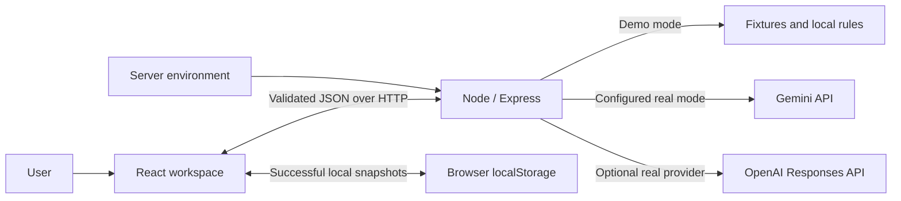

# High-Level Design (HLD): Promptly

Version: 1.0, including review and browser-local history improvements

Document date: 15 November 2026

Status: Architecture of the implemented application

## 1. Purpose and architectural goals

Promptly turns source text into a structured summary, rewritten draft, or action checklist. The architecture supports one main screen and one processing endpoint, with provider credentials owned by the backend. Local review, comparison, editing, completion, and history do not require additional AI requests.

The design prioritizes a small deployable system, shared contracts, clear data ownership, predictable state transitions, and explicit failure handling. Product requirements are in [PRD.md](PRD.md); implementation detail is in [LLD.md](LLD.md).

## 2. System context



Only one engine is selected for a server configuration. Gemini and OpenAI are alternatives, not a chain of fallback services. Demo mode is explicit. There is no server database or authentication service.

## 3. Major components and responsibilities

| Component | Responsibility | Main source |
| --- | --- | --- |
| React workspace | Collect source/preferences; show request state; coordinate review, edits, completion, and history | `client/src/App.jsx` |
| Editor and result components | Render source, structured output, editable fields, comparison, exact evidence, and export controls | `client/src/components/` |
| Client API adapter | Send JSON, handle HTTP/network errors, and validate mode-specific response envelopes | `client/src/lib/api.js` |
| Workspace reducer | Transition request/result state; preserve generated output; reject stale completions | `client/src/lib/workspace.js` |
| Local history adapter | Validate, bound, save, restore, update, and delete browser snapshots | `client/src/lib/history.js` |
| Shared contracts | Define request, response, operation output schemas, enums, and limits | `shared/schemas.js` |
| Express application | Apply middleware; expose `POST /api/process`; validate input/output; serve the production build | `server/app.js` |
| Engine adapters | Run demo rules or call the configured provider; normalize provider failures | `server/services/` |
| Prompt builder | Produce operation-specific instructions without treating source content as instructions | `server/prompts/templates.js` |
| Configuration and errors | Validate environment at startup; keep credentials server-side; return safe errors | `server/config.js`, `server/middleware/errors.js` |

## 4. Primary processing flow

1. The user chooses a mode and supplies source text plus relevant preferences.
2. The client validates the request with the shared Zod contract, creates an abort controller/request version, and enters loading state.
3. The browser sends JSON to `/api/process`. Vite proxies that route during development; the production frontend and API share the Express origin.
4. Express attaches a request ID and applies headers, origin/CORS checks, rate limiting, JSON-size checks, and request validation.
5. The configured engine processes the validated request. Real mode builds instructions and uses the operation's structured output schema; demo mode uses fixtures/local rules.
6. The adapter and API validate the output. The API adds provider, duration, word count, and request-ID metadata.
7. The client validates the response envelope and mode. Only the active request may become the visible result.
8. The successful snapshot is retained in bounded local history. Later result edits, task completion, comparison, and export happen in the browser.

```mermaid
sequenceDiagram
    actor User
    participant UI as React client
    participant API as Express API
    participant Engine as Configured engine
    participant Local as localStorage
    User->>UI: Source + mode + preferences
    UI->>UI: Validate request; enter loading
    UI->>API: POST /api/process
    API->>API: Middleware and request validation
    API->>Engine: Validated input + output contract
    Engine-->>API: Structured result or safe error
    API->>API: Validate output; attach metadata
    API-->>UI: Result envelope
    UI->>UI: Validate mode/schema; check request version
    UI->>Local: Save successful snapshot
    UI-->>User: Reviewable result
```

## 5. Data ownership and persistence

The source editor owns the original text. Generated output is retained separately from an optional edited result. The displayed result is derived from the edited version when present, otherwise the generated version. Completion is a separate index-to-boolean map; totals and filtered rows are calculated from it.

The server processes a request without storing source/result content in a database. It retains operational state such as the in-memory rate-limit counters. Logs omit source text, credentials, and raw upstream errors.

Browser history contains IDs, generation timestamps, exact original source, validated request/preferences, generated response/metadata, optional edits, and completion. It is limited to 20 results and a serialized-size budget. New generations displace older ones. Reopening is a local restore and does not call AI. Deletion detaches an open result from history so subsequent local edits do not recreate the deleted record.

History is specific to browser storage and origin, readable by that origin, and not encrypted by the application. There is no cloud backup, device sync, or multi-tab reconciliation. In real mode, source still travels to the provider; server non-persistence is not a statement about provider retention.

## 6. Provider integration and contracts

Gemini is the default real-mode provider, with configured model `gemini-3.5-flash-lite`. The server uses native fetch to call `generateContent`. Zod output schemas are converted to JSON Schema, and JSON response MIME type/schema are included in the generation configuration. The API key is sent only in a server-side header.

The optional OpenAI adapter uses the Responses API with the Zod helper and `store: false`. This setting is not a claim of universal zero retention by the provider.

Both real adapters return the same operation-specific result shape as demo mode. They detect malformed output and provider failures. They do not automatically retry, switch providers, or silently fall back to demo. Users can explicitly retry from the interface.

## 7. Security and trust boundaries

| Boundary | Implemented measures and limits |
| --- | --- |
| Browser to server | Shared input validation, JSON content type, 100 KB body limit, exact configured origin checks, and an in-memory per-IP API limiter. Origin checks are not authentication and do not stop arbitrary non-browser clients. |
| Server configuration | Zod startup validation; selected real-mode provider requires a nonempty key; `.env` is ignored by Git; no client-side `VITE_` key. |
| Source to model | Separate instructions and source payload; prompts require source to be treated as untrusted material. This reduces risk but does not prove resistance to all prompt injection. |
| Provider to UI | JSON parsing and mode-specific Zod validation; safe error mapping; normal React text rendering instead of executing provider HTML. |
| Browser storage | Version/shape checks, mode alignment, source consistency, edit-schema validation, evidence integrity checks, duplicate handling, and bounded retention. Storage is still client-controlled. |

Helmet configures production same-origin policies, and Express disables its identifying header. TLS termination and related transport policy belong to the deployment environment. The current server does not enable HSTS itself.

## 8. Deployment and configuration

Development uses Node 22.12 or newer, Vite on `127.0.0.1:5173`, and Express on `127.0.0.1:3001` by default. `npm run dev` starts both. No credentials are needed for default demo mode.

Production uses `npm run build` followed by `npm start`; Express serves `dist/` and the API. Set `NODE_ENV=production` to enable the production CSP. Configure the exact client origin, host/port, trusted proxy hops, and provider settings for the environment. Put TLS in front of a hosted deployment. Fonts are self-hosted assets.

Relevant settings are `DEMO_MODE`, `AI_PROVIDER`, provider key/model variables, `HOST`, `PORT`, `CLIENT_ORIGIN`, `AI_TIMEOUT_MS`, and `TRUST_PROXY_HOPS`. See [.env.example](.env.example) and [README.md](README.md). No real secret belongs in documentation.

## 9. Reliability, performance, and growth limits

The provider timeout defaults to 30 seconds and the browser timeout is 45 seconds. Browser cancellation aborts its fetch and invalidates the request version; it is not propagated through Express to guarantee provider cancellation or avoided billing. Timeouts, refusals, configuration failures, rate limits, and malformed responses have explicit safe errors.

Comparison is computed locally with a bounded longest-common-subsequence matrix and grouped fallback. History has a bounded count/size. Pane scrolling, Focus view, and responsive one-pane mobile navigation keep the editor manageable. No measured throughput or availability SLA is claimed.

The rate limiter is process-local. Multiple server instances would need a shared limiter. A public paid service would also require access control, account-level quotas, stronger operational monitoring, and an explicit privacy/retention design. Those are future architecture considerations, not implemented features.

## 10. Design decisions and verification

| Decision | Reason |
| --- | --- |
| One processing endpoint | The tools share validation, transport, error handling, and response metadata; mode-specific contracts express the differences. |
| Shared Zod contracts | Keep UI validation, API validation, and AI schema generation aligned. |
| Provider adapters | Keep engine transport and error handling out of UI and route logic. |
| No server database | The current task needs local continuity rather than accounts or cross-device history. |
| Reducer plus request versions | Make success/error/reset/restore transitions explicit and prevent stale UI updates. |
| Separate generated and edited results | Support accurate reset, provenance, and consistent exports. |

The last application verification passed 68 automated checks, 25 browser scenarios, and a production build. Provider tests use mocked transport; no paid call is needed for repeatable validation. [TESTING.md](TESTING.md) records evidence and limits. [DESIGN.md](DESIGN.md) explains the visual system, while [CONCEPTS.md](CONCEPTS.md) maps demonstrable engineering concepts.
